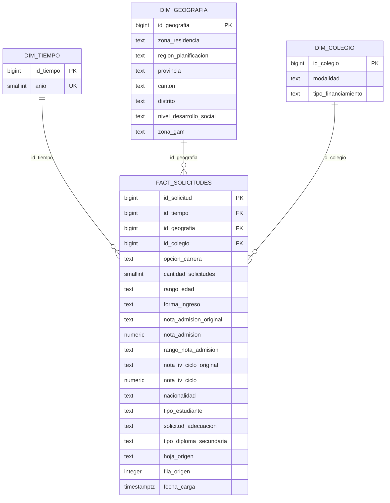

# Diccionario de datos y diseño dimensional — Componente A: Solicitudes

Versión 1.0. Fuente oficial: `Datos proyecto BI v2.xlsx`. Motor: PostgreSQL. Esquema: `bi`.

## Granularidad

Una fila de `fact_solicitudes` representa un registro de solicitante de primera o segunda opción; no necesariamente una persona única. La medida `cantidad_solicitudes` vale 1 por registro.

## Diagrama

## Diccionario físico

El documento DOCX contiene el diccionario completo de las 33 columnas, restricciones, reglas de negocio, alcance y limitaciones de validación.

## Estado de validación

- 4 tablas encontradas en el esquema `bi`.
- 33 columnas consultadas en `information_schema.columns`.
- 15 restricciones consultadas en `pg_constraint`.
- 3 llaves foráneas verificadas.
- 0 registros en las cuatro tablas al momento de la revisión.
- ETL y carga de datos todavía no ejecutados ni validados.
